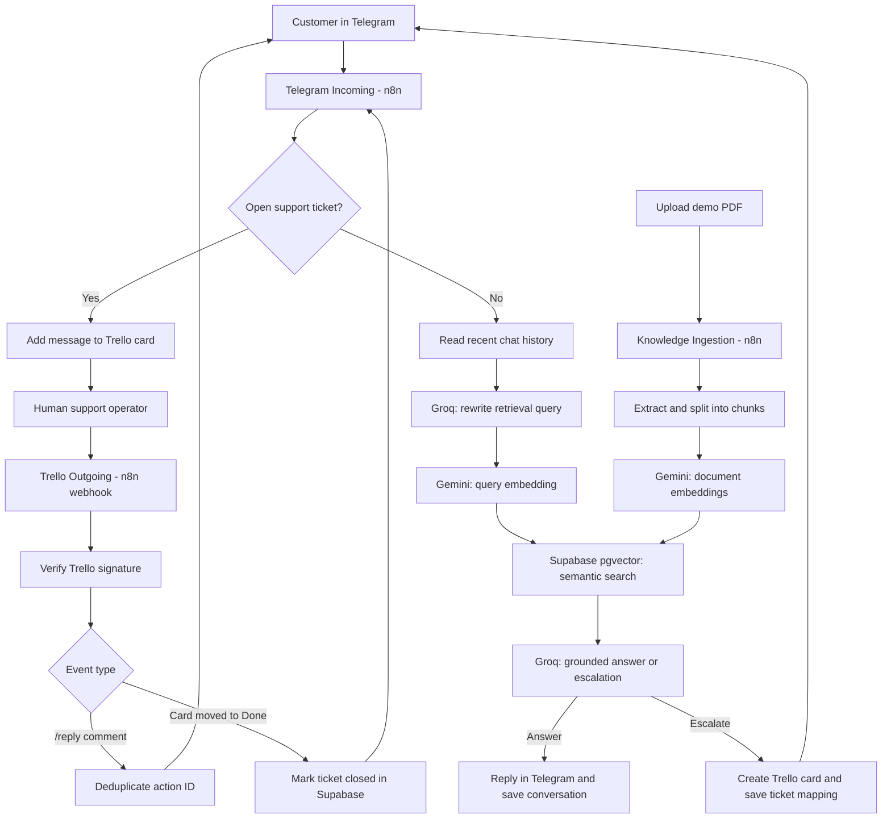

# SupportFlow AI

**An AI-powered customer support assistant built with n8n, RAG, and human escalation through Trello.**

SupportFlow AI is a portfolio/pet project that demonstrates a practical customer-support workflow: a customer messages a Telegram bot, an LLM answers questions using a company knowledge base, and questions that require human judgment are handed over to a support operator in Trello. The customer and operator continue the conversation through Telegram and Trello without switching to a new chat.

> **Demo only.** FitLife is a fictional company. The included knowledge base contains synthetic policies and should not be interpreted as real business guidance.

## Features

- **Telegram support bot** with a simple text-only chat interface.
- **Retrieval-augmented generation (RAG):** semantically retrieves relevant information from a PDF knowledge base before answering.
- **Conversation memory:** retrieves recent user/assistant messages from Supabase for follow-up questions.
- **Context-aware retrieval:** rewrites context-dependent questions into standalone queries before vector search.
- **Structured AI routing:** the LLM returns a validated JSON decision (`answer` or `escalate`).
- **Human handoff:** creates a Trello ticket for refund requests, billing disputes, unresolved technical problems, or insufficient knowledge.
- **Two-way operator messaging:** forwards new customer messages to their open Trello ticket, and sends Trello comments prefixed with `/reply ` back to the same Telegram chat.
- **Ticket closure:** moving a Trello card to the Done list updates its Supabase status to `closed`; the user's next message can return to the AI flow.
- **Webhook validation and basic deduplication:** verifies the Trello webhook signature and tracks operator replies by Trello action ID.

## Architecture



Three independent n8n workflows handle different events. **They are intentionally not merged into one canvas.**

| Workflow | Trigger | Responsibility |
| --- | --- | --- |
| `telegram-support.json` | Telegram webhook | Handle `/start`, check open tickets, retrieve memory and knowledge, answer or escalate |
| `trello-outgoing.json` | Trello webhook | Validate events, forward operator replies, close tickets |
| `knowledge-ingestion.json` | n8n upload form | Extract PDF text, split it into sections, generate 768-dimensional embeddings, upsert chunks |

## Tech stack

| Layer | Technology |
| --- | --- |
| Workflow orchestration | n8n Cloud |
| Chat interface | Telegram Bot API |
| AI inference and query rewriting | Groq API (`openai/gpt-oss-20b`) |
| Embeddings | Google Gemini Embedding API (`gemini-embedding-001`, 768 dimensions) |
| Database and vector search | Supabase PostgreSQL + pgvector |
| Human support ticket board | Trello REST API and webhooks |
| Data transformations | JavaScript in n8n Code nodes |

## n8n Workflows

### 1. Telegram Incoming
Handles incoming Telegram messages, checks for existing open tickets, queries the knowledge base, generates an AI response, and either replies directly or escalates to Trello.


### 2. Knowledge Ingestion
Processes support knowledge base documents, generates embeddings, and stores them in Supabase for RAG retrieval.


### 3. Trello Outgoing
Handles operator replies from Trello comments and sends them back to the Telegram user.

)


## Repository structure

```text
SupportFlow-AI/
├── README.md
├── .gitignore
├── workflows/
│   ├── telegram-support.json
│   ├── trello-outgoing.json
│   └── knowledge-ingestion.json
├── database/
│   └── schema.sql
└── sample-data/
    └── FitLife_Knowledge_Base_Test.pdf
```

## Run your own demo

**Prerequisites:** an n8n instance, a Telegram bot token, a Trello board and API credentials, a Supabase project, a Groq API key, and a Google Gemini API key.

1. **Prepare Supabase.** Enable pgvector and run [`database/schema.sql`](database/schema.sql) in the SQL editor. This is a *reference schema recreated to match the exported workflows*, not an export of the author's original database migrations. Use an appropriate **server-side** Supabase secret/service-role key in n8n, never in a client application.
2. **Import the workflows.** In n8n, use **Import from File** to import the three JSON files in [`workflows/`](workflows/). They have been sanitized and are disabled by default.
3. **Configure credentials.** Reconnect the HTTP Request credentials for Supabase, Groq, Google Gemini, and Trello, plus the HMAC secret in the Crypto node. Configure the Telegram Bot API token for the Telegram send-message requests.
4. **Replace placeholders** in the imported workflows:
   - `YOUR_PROJECT_REF` — Supabase project reference in REST URLs.
   - `YOUR_TELEGRAM_BOT_TOKEN` — Telegram Bot API token. **Do not commit a filled-in workflow export.**
   - `YOUR_TRELLO_TODO_LIST_ID` and `YOUR_TRELLO_DONE_LIST_ID` — Trello list IDs.
   - `YOUR_N8N_TRELLO_WEBHOOK_URL` — exact production callback URL registered with Trello, used when validating the HMAC signature.
5. **Register webhooks.** Activate the Telegram and Trello workflows, register Telegram's webhook with the Telegram workflow's **production** URL, and register a Trello board webhook pointing at the Trello workflow's **production** URL. The callback URL used by Trello must match the URL used to calculate its HMAC signature **exactly**.
6. **Build the knowledge base.** Open the n8n form from `knowledge-ingestion.json` and upload the PDF from [`sample-data/`](sample-data/). The demo ingestion workflow is designed for this PDF's heading-based structure. Confirm that `knowledge_chunks` contains the generated embeddings.
7. **Try the Telegram bot.** Send `/start`, then ask about subscription cancellation or restoring purchases. Try a refund request to trigger escalation.

**Important:** Reconnect credentials in n8n after importing; the published files do not contain working tokens or account-specific credentials. Do not paste production credentials or customer data into a public repository.

## Demo walkthrough

1. **Knowledge answer:** ask *“How can I restore my Premium purchases?”* The bot retrieves the relevant policy and responds.
2. **Human escalation:** ask *“Can you refund my subscription?”* The bot opens a Trello card, saves the mapping to the Telegram chat, and confirms the handoff.
3. **Conversation during an open ticket:** send another Telegram message. It is added as a comment to the existing Trello card instead of being answered by AI.
4. **Operator response:** comment `/reply Your request is being reviewed.` on the card. The customer receives the message in Telegram.
5. **Close the ticket:** move the card into the configured Done list. Supabase updates the ticket to `closed`. Subsequent Telegram messages go through the AI flow again.

## Database model

- `chat_messages` — customer/assistant message history for conversational context.
- `knowledge_chunks` — PDF text chunks and 768-dimensional embeddings.
- `support_tickets` — mapping between a Telegram chat and a Trello card, with `open`/`closed` status.
- `trello_reply_events` — tracking of outgoing operator replies and protection from duplicate Trello events.

The vector search function `match_knowledge_chunks` returns the most similar document sections. See [`database/schema.sql`](database/schema.sql) for a minimal reproducible reference schema.
